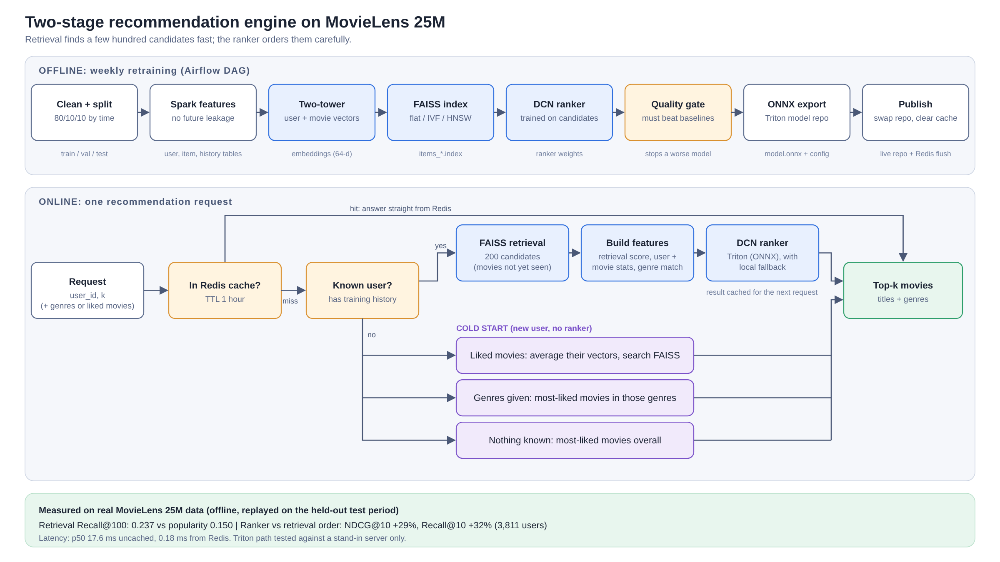

# Large-Scale Personalized Recommendation Engine

A two-stage movie recommender on MovieLens 25M, built like the systems behind "Recommended for you" on
Netflix or Amazon. Stage one finds a few hundred candidates in milliseconds. Stage two scores only those
candidates with a richer model. New users get explicit fallbacks.



## Results at a glance

All numbers come from real runs on MovieLens 25M. Full tables and caveats are in [docs/RESULTS.md](docs/RESULTS.md).

| What | Result |
|---|---|
| Retrieval vs "most popular" baseline (5,063 warm users, validation period) | Recall@100 **0.237 vs 0.150**, Recall@10 0.047 vs 0.032 |
| FAISS HNSW vs exact search (26k movies) | **0.076 ms vs 0.79 ms** per query, 97% of the exact top 100 found |
| Ranker vs retrieval order (replay A/B on the held-out test period, 3,811 users) | NDCG@10 **+29%**, Recall@10 +32%, hit rate +20% (paired, 95% intervals above zero) |
| Latency (single thread, local Redis) | p50 **17.6 ms** uncached, **0.18 ms** from Redis cache |

**What these numbers are not:** the A/B test is an offline *replay* on held-out ratings, not live traffic.
Results cover users who have history; new users are served by the fallbacks, which are not evaluated offline.
Triton and Airflow are built and checked, but no real Triton server or Airflow run was executed (see Limitations).

## How it works, in short

1. **Data** (`src/data`): clean MovieLens 25M, split **by time** (80/10/10) so training never sees the future.
2. **Features** (`src/features`, Spark): user and movie statistics computed only from earlier interactions (no leakage).
3. **Retrieval** (`src/retrieval`): a two-tower model (TensorFlow Recommenders) gives every user and movie a 64-number
   vector. A user's nearest movie vectors are the candidates. FAISS indexes the movie vectors.
4. **Ranking** (`src/ranking`): a Deep & Cross Network (DCN) scores each of ~200 candidates from the retrieval score,
   user and movie statistics, and genre match.
5. **Serving** (`src/serving`): known user -> FAISS -> ranker -> top N, cached in Redis. New user -> popularity,
   genre, or "average of liked movies" fallback. The ranker also exports to ONNX for Triton.
6. **Pipeline** (`airflow`, `src/pipeline`): weekly retraining DAG with a quality gate that blocks a worse model.

The long version, with the reasoning behind each choice, is in [docs/HOW_IT_WORKS.md](docs/HOW_IT_WORKS.md).

## Repository layout

```
src/data/prepare_data.py            clean + time split
src/features/build_features.py      Spark user / movie / history features
src/retrieval/train_two_tower.py    two-tower model, evaluation vs popularity
src/retrieval/build_faiss_index.py  flat / IVF / HNSW indexes + benchmark
src/ranking/train_candidate_ranker.py   the ranker used in production (trained on retrieval candidates)
src/ranking/train_ranker.py         first pointwise ranker (kept: documents what did not work) + shared helpers
src/serving/recommender.py          the recommender: ranker path, cold-start paths, Redis cache, optional Triton
src/serving/ab_test.py              replay A/B test on the test period
src/serving/benchmark.py            latency benchmark
src/serving/export_triton.py        ONNX export + Triton model repository + parity check
src/pipeline/quality_gate.py        refuses to publish a worse model
src/pipeline/publish.py             swaps the model repository, clears stale cache
airflow/dags/recsys_retrain_dag.py  weekly retraining DAG
app/demo_app.py                     Gradio demo
notebooks/colab_pipeline.ipynb      the full run order for Google Colab
tests/                              unit tests (no dataset needed)
docs/                               architecture, data + API, results, how it works
```

## Setup

Python 3.12 or 3.13. Spark needs Java 11 or 17.

```bash
python -m venv .venv && source .venv/bin/activate
pip install -r requirements.txt
pytest -q                      # fast checks, no dataset needed
```

Quick smoke test on fake data (about 2 minutes, no download):

```bash
python src/data/prepare_data.py --synthetic --out data/processed
python src/features/build_features.py --data data/processed --out data/features
python src/retrieval/train_two_tower.py --out models/retrieval --epochs 2 --batch 512 --eval-users 500
```

## Running the full pipeline

Download [MovieLens 25M](https://grouplens.org/datasets/movielens/25m/) and unzip it to `data/raw/ml-25m/`.
The full run took roughly: step 1 about 5 min, step 2 about 10-30 min, retrieval about 27 min per epoch on a
Colab CPU (much faster on a GPU), ranker a few minutes. [notebooks/colab_pipeline.ipynb](notebooks/colab_pipeline.ipynb)
holds the exact cells, including saving to Google Drive between steps (Colab wipes local disk on disconnect).

```bash
python src/data/prepare_data.py --raw data/raw/ml-25m --out data/processed
python src/features/build_features.py --data data/processed --out data/features
python src/retrieval/train_two_tower.py --data data/processed --out models/retrieval --epochs 3 --batch 4096
python src/retrieval/build_faiss_index.py --emb models/retrieval --out models/faiss
python src/ranking/train_candidate_ranker.py --data data/processed --features data/features \
       --retrieval models/retrieval --faiss models/faiss --out models/ranking_v3
python src/serving/ab_test.py        # replay A/B on the test period
python src/serving/benchmark.py      # add --redis localhost:6379 for the cached numbers
python src/serving/export_triton.py  # writes model_repository/ and checks ONNX against Keras
```

## Demo

```bash
pip install -r requirements-extra.txt
python app/demo_app.py --artifacts-root . --data data/processed --features data/features \
       --retrieval models/retrieval --faiss models/faiss --ranking models/ranking_v3 --redis localhost:6379
```

Pick an existing user (shows their favourite genres and recent likes next to the recommendations, plus
the path used, cache status and latency) or describe a new user by genres or liked movies. In Colab add `--share`.

## Serving on Triton

`export_triton.py` writes `model_repository/candidate_ranker/{config.pbtxt, 1/model.onnx}` with the feature
standardisation baked in. ONNX is used because NVIDIA deprecated Triton's TensorFlow backend from release 25.03.
Start Triton with `--model-control-mode=poll`, then run the recommender with `--triton localhost:8000`.
If the server is unreachable the recommender falls back to its local ranker.

## Limitations (please read)

- **The A/B test is a replay on held-out ratings.** There was no live traffic, so no real click-through is claimed.
  It also only sees movies users chose to rate and has no model of position bias.
- **Triton was not run against a real server.** The export is checked against the original model (max difference
  8.9e-8 on the trained ranker, 2,048 rows) and the client against a stand-in server that speaks Triton's request format.
- **The Airflow DAG loads and is structurally valid** (Airflow 3.x), but its tasks were not executed end to end.
  The "weekly retrain" runs on a static dataset, so it would reproduce the same models until new data arrives.
- **Cold-start users are not evaluated offline.** The "average of liked movies" path is a heuristic.
- **Candidate pool caps recall.** The 200 retrieved candidates contain about 30% of a user's later likes.
- **Training is not bit-for-bit repeatable.** On the synthetic test the ranker AUC varied by about +/-0.03 between
  identical runs, so quote results as approximate and rerun before comparing small differences.

## Tests

`pytest -q` covers the time split, label threshold, the quality gate, the model-repository swap, the Redis cache
clearing, arm assignment and the ranking metrics (checked against values worked out by hand).
